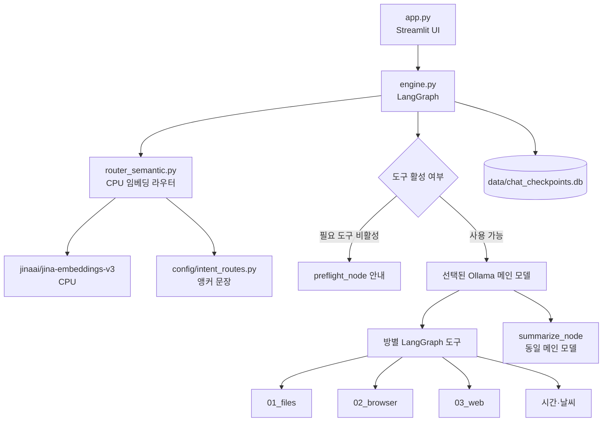

# Local Agent: 로컬 LLM 기반 작업 에이전트

[](https://www.python.org/)
[](https://ollama.com/)
[](https://streamlit.io/)
[](https://langchain-ai.github.io/langgraph/)
[](https://www.langchain.com/)
[](https://www.sqlite.org/)

Ollama 로컬 모델과 LangGraph를 기반으로 대화, 파일 작업, 시간·날씨 조회, 웹·쇼핑 검색 및 Chrome 방문 기록 조회를 제공하는 Streamlit 애플리케이션입니다. 의도 분류는 CPU 임베딩 라우터가 담당하고, 요청에 따라 방별 도구를 메인 모델에 연결합니다.

메인 모델 추론과 파일 처리는 로컬에서 수행합니다. 시맨틱 라우터는 최초 실행 시 임베딩 모델을 내려받을 수 있으며, 웹·쇼핑 검색과 날씨 조회에는 네트워크 연결이 필요합니다.

---

## 주요 특징

- **CPU 시맨틱 라우팅**: `jinaai/jina-embeddings-v3` 임베딩과 `config/intent_routes.py` 앵커 매칭으로 요청 의도를 분류합니다. 별도 라우터 LLM을 실행하지 않아 GPU 메모리에서 모델을 교체하지 않습니다.
- **도구 사전 점검**: 비활성화된 파일·브라우저·웹 도구가 필요한 요청은 `preflight_node`에서 메인 LLM 호출 전에 안내합니다.
- **Smart Pass**: 검색 조건이나 대상에 대한 단서가 있으면 도구를 바로 호출하고, 작업 단서가 전혀 없을 때만 필요한 조건을 질문합니다.
- **방별 도구와 프롬프트**: Streamlit에서 페르소나 및 도구 그룹을 선택하고 LangGraph에서 해당 도구만 연결합니다.
- **컨텍스트 관리**: 방별 SQLite 체크포인트를 사용하며, 오래된 대화는 현재 선택한 메인 모델로 요약합니다.

## 기술 스택

| 구분 | 기술 |
|---|---|
| 언어 및 UI | Python 3.10+, Streamlit |
| 에이전트 오케스트레이션 | LangGraph |
| 모델 통합 및 서빙 | LangChain Core, `langchain-ollama`, Ollama |
| 시맨틱 라우팅 | Sentence Transformers, `jinaai/jina-embeddings-v3`, CPU |
| 웹 수집 | HTTPX, Beautiful Soup |
| 대화 상태 | SQLite, LangGraph SQLite Checkpointer |

---

## 시스템 아키텍처



라우터는 `chat`, `files`, `browser`, `web`, `time`, `weather` 의도를 CPU 임베딩 앵커와 비교합니다. 별도 라우터 LLM 호출 없이 분류하고, 도구 그룹이 비활성화된 파일·브라우저·웹 요청은 메인 모델 호출 전에 `preflight_node`에서 차단합니다.

## 디렉터리 구조

```
LocalAgent/
├── app.py
├── engine.py
├── router_semantic.py
├── prompt_loader.py
├── room_manager.py
├── config/
│   ├── settings.py              # 로컬 설정
│   ├── settings.py.example      # 공개 설정 예시
│   ├── intent_routes.py         # 라우터 앵커
│   └── categories.py
├── tools/
│   ├── __init__.py              # 도구 스키마와 TOOL_REGISTRY
│   ├── files.py
│   ├── browser.py
│   ├── web_shopping.py
│   └── chat_utils.py
├── prompts/
│   ├── persona/
│   ├── tools/                   # 01_files, 02_browser, 03_web
│   ├── workflow/
│   ├── context_summary.md
│   └── context_summary.md.example
├── legacy/agent.py              # 아카이브된 구형 CLI
├── data/                        # rooms.json, chat_checkpoints.db
├── cache/search_cache.json
├── search_result/
├── .github/copilot-instructions.md
├── requirements.txt
└── tests/
```

## 도구 번들과 Smart Pass

| 프롬프트 번들 | 기능 |
|---|---|
| `01_files` | 로컬 파일·폴더 탐색, 파일 읽기·쓰기·이동·삭제 및 검색 결과 내보내기 |
| `02_browser` | Chrome 방문 기록 SQLite 조회. 시간 도구가 반환하는 날짜 lookup table로 상대 날짜를 절대 날짜로 해석합니다. |
| `03_web` (`tools/web_shopping.py`) | 다나와 통합검색 결과에서 상품 사양을 수집하고, 결과가 없거나 요청이 실패하면 DuckDuckGo 검색으로 폴백합니다. |

웹·쇼핑 결과에는 Python 필터를 적용합니다. `include_keywords`는 일치 결과를 우선 정렬하고 `exclude_keywords`는 명확히 포함된 옵션을 제외합니다. 부정 표현 때문에 제외 여부가 모호한 항목은 `[문맥확인필요]`로 표시합니다. `fetch_page_details`는 공개 웹페이지의 본문과 표를 제한된 크기로 추출합니다.

워크플로 프롬프트는 Smart Pass를 적용합니다. 파일·웹 검색에 필요한 경로나 키워드·조건 중 하나라도 있으면 바로 탐색하고, 작업 단서가 전혀 없거나 결과를 좌우할 필수 조건이 빠진 경우에만 질문합니다.

브라우저 조회의 현재 구현 범위는 **Chrome 방문 기록**입니다. Edge 기록과 브라우저 북마크 SQLite 조회는 아직 제공하지 않습니다.

## 컨텍스트 요약

`should_summarize`는 대화 메시지와 tool call의 문자 길이를 합산해 2.5로 나눈 토큰 추정치를 계산합니다. 추정치가 12,000을 초과하면 에이전트 응답 이후 `summarize_node`가 호출되어 오래된 대화를 요약하고 최근 4개 메시지를 유지합니다.

요약은 별도 소형 모델 대신 현재 선택된 메인 모델로 수행합니다. 요약 호출에는 `reasoning=False`와 `think=False`를 적용하고, 지침은 `prompts/context_summary.md`에서 읽습니다. 요약 프롬프트는 탐색 경로, 검색 조건, 주요 결과와 핵심 수치를 보존하도록 작성되어야 합니다.

## 설치 및 실행

### 요구 사항
- Python 3.10 이상
- Ollama와 선택한 메인 모델
- 최초 임베딩 모델 다운로드 및 웹·날씨 기능 사용을 위한 네트워크 연결

### 환경 설정
```powershell
python -m venv .venv
.\.venv\Scripts\Activate.ps1
python -m pip install -r requirements.txt
Copy-Item config/settings.py.example config/settings.py
```

`config/settings.py`는 로컬 설정 파일입니다. 복사한 뒤 `MODEL_PROFILES`의 예시 모델 이름을 사용할 Ollama 모델로 바꾸고 선택 프로필을 확인합니다. Ollama에서 해당 모델을 내려받습니다. 예를 들어:

```bash
ollama pull gemma4:12b
```

각 `.md.example`은 공개용 템플릿이며 런타임에서 자동으로 대체 사용하지 않습니다. 사용할 기능 프롬프트는 대응하는 `.md.example`을 `.md` 파일로 복사해 활성화하고 내용을 설정합니다. 페르소나 디렉터리에는 공통 규칙 템플릿과 대표 이름 샘플만 제공하며, 개인 페르소나 파일은 필요에 따라 직접 작성합니다.

### 실행
```bash
streamlit run app.py
```

## 로컬 데이터와 네트워크

- 채팅방 설정과 메시지: `data/rooms.json`
- LangGraph 체크포인트: `data/chat_checkpoints.db`
- 파일 검색 캐시: `cache/search_cache.json`
- 검색 결과 내보내기: `search_result/`
- 웹·쇼핑 검색은 다나와와 DuckDuckGo를, 날씨 조회는 `wttr.in`을 이용합니다. 최초 시맨틱 라우터 모델이 로컬 캐시에 없으면 내려받기가 필요합니다.
- `data/`, `cache/`, `search_result/`, 실제 `.md` 프롬프트와 `config/settings.py`는 로컬 데이터 또는 설정입니다. 공개 저장소에는 민감한 내용 대신 예시 템플릿을 사용합니다.