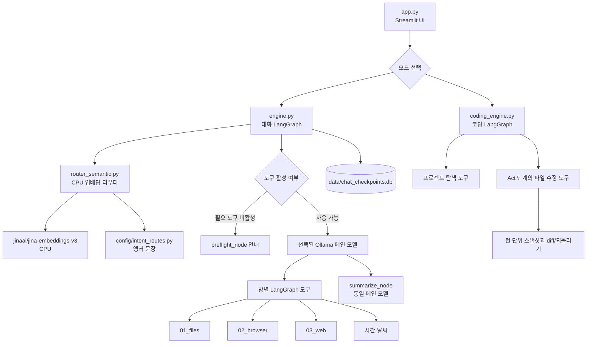

# Local Agent: 로컬 LLM 기반 작업 에이전트

[](https://www.python.org/)
[](https://ollama.com/)
[](https://streamlit.io/)
[](https://langchain-ai.github.io/langgraph/)
[](https://www.langchain.com/)
[](https://www.sqlite.org/)

Ollama 로컬 모델과 LangGraph를 기반으로 일반 대화와 코딩 워크스페이스, 파일 작업, 시간·날씨 조회, 웹·쇼핑 검색 및 Chrome 방문 기록 조회를 제공하는 Streamlit 애플리케이션입니다. 일반 대화는 CPU 임베딩 라우터가 의도를 분류하고, 코딩 모드는 사용자가 지정한 프로젝트 폴더 안에서 코드를 탐색하고 수정합니다.

메인 모델 추론과 파일 처리는 로컬에서 수행합니다. 시맨틱 라우터는 최초 실행 시 임베딩 모델을 내려받을 수 있으며, 웹·쇼핑 검색과 날씨 조회에는 네트워크 연결이 필요합니다.

또한 지속적으로 개발 및 업데이트되고 있으므로, 리드미 내용이 추가적으로 업데이트 되는것을 확인해주세요.

## 누가 개발했나요?

<table>
  <tr>
    <td><a href="https://sungjin-park530.github.io/web_portfolio/"></a></td>
    <td>저 '박성진'이 기획부터 개발까지 모두 담당했습니다. </br> 좌측 이미지를 클릭하시면 <b>포트폴리오 페이지</b>로 이동합니다! </td>
  </tr>
</table>

### 목차

Local Agent<br>
├── [빠른 사용](#quick-usage)<br>
├── [주요 특징](#key-features)<br>
├── [기술 스택](#tech-stack)<br>
├── [시스템 아키텍처](#architecture)<br>
├── [핵심 디렉터리](#core-directories)<br>
├── [기능 안내](#feature-guide)<br>
│   ├── [대화와 도구](#chat-tools)<br>
│   ├── [코딩 워크스페이스](#coding-workspace)<br>
│   └── [대화 컨텍스트 관리](#conversation-context)<br>
├── [설치 및 실행](#setup-run)<br>
└── [로컬 데이터와 네트워크](#local-data)

---

<a id="quick-usage"></a>
## 빠른 사용

```bash
streamlit run app.py
```
환경 설정이 끝난 뒤 프로젝트 루트에서 `streamlit run app.py`를 실행합니다.

- 채팅 에이전트
    1. 사이드바에서 **일반 채팅**를 선택합니다.
    2. 채팅방의 페르소나와 도구 그룹을 지정합니다.
    3. 원하는 작업을 지시하고 결과 보고를 받습니다.

- 코딩 에이전트
    1. 사이드바에서 **코딩 모드**를 선택합니다.
    2. 작업 프로젝트 폴더와 코딩 모델, 워크플로를 지정합니다.
    3. **계획 먼저 수립**은 계획을 검토한 뒤 승인 버튼으로 수정을 시작하고, **즉시 수정 실행**은 요청을 바로 수행합니다.
    4. 작업 결과 코드와 보고를 받습니다.

<a id="key-features"></a>
## 주요 특징

- **CPU 시맨틱 라우팅**: `jinaai/jina-embeddings-v3` 임베딩과 `config/intent_routes.py` 앵커 매칭으로 요청 의도를 분류합니다. 별도 라우터 LLM을 실행하지 않아 GPU 메모리에서 모델을 교체하지 않습니다.
- **도구 사전 점검**: 비활성화된 파일·브라우저·웹 도구가 필요한 요청은 `preflight_node`에서 메인 LLM 호출 전에 안내합니다.
- **Smart Pass**: 검색 조건이나 대상에 대한 단서가 있으면 도구를 바로 호출하고, 작업 단서가 전혀 없을 때만 필요한 조건을 질문합니다.
- **방별 도구와 프롬프트**: Streamlit에서 페르소나 및 도구 그룹을 선택하고 LangGraph에서 해당 도구만 연결합니다.
- **컨텍스트 관리**: 방별 SQLite 체크포인트를 사용하며, 오래된 대화는 현재 선택한 메인 모델로 요약합니다.
- **코딩 워크스페이스**: 지정한 프로젝트를 읽고 검색한 뒤 코드를 수정합니다. Plan → Act 승인 흐름, 자동 수정 흐름, 현재 턴 diff 확인 및 되돌리기를 제공합니다.

<a id="tech-stack"></a>
## 기술 스택

| 구분 | 기술 |
|---|---|
| 언어 및 UI | Python 3.10+, Streamlit |
| 에이전트 오케스트레이션 | LangGraph |
| 모델 통합 및 서빙 | LangChain Core, `langchain-ollama`, Ollama |
| 시맨틱 라우팅 | Sentence Transformers, `jinaai/jina-embeddings-v3`, CPU |
| 웹 수집 | HTTPX, Beautiful Soup |
| 대화 상태 | SQLite, LangGraph SQLite Checkpointer |

---

<a id="architecture"></a>
## 시스템 아키텍처



일반 채팅은 `chat`, `files`, `browser`, `web`, `time`, `weather` 의도를 CPU 임베딩 앵커와 비교합니다. 별도 라우터 LLM 호출 없이 분류하고, 도구 그룹이 비활성화된 파일·브라우저·웹 요청은 메인 모델 호출 전에 `preflight_node`에서 안내합니다. 코딩 모드는 별도의 `coding_engine.py` 그래프에서 실행되며 지정한 워크스페이스에 도구를 바인딩합니다.

<a id="core-directories"></a>
## 핵심 디렉터리

```
LocalAgent/
├── app.py
├── engine.py                 # 일반 대화 그래프
├── coding_engine.py          # 코딩 모드 그래프
├── router_semantic.py        # 일반 채팅 의도 분류
├── views/                    # 채팅·코딩 화면
├── tools/                    # 대화 도구와 코딩 워크스페이스 도구
├── prompts/                  # 페르소나·도구·워크플로·코딩 지침
├── config/
│   ├── settings.py.example     # 로컬 설정의 공개 예시
│   └── intent_routes.py        # 라우터 앵커 문장
├── data/                       # 채팅방 설정과 대화 체크포인트
├── cache/                      # 검색 캐시
├── search_result/              # 내보낸 검색 결과
├── tests/                      # 자동화 테스트
└── requirements.txt
```

이 구조는 실행 진입점, 대화와 코딩의 두 실행 경로, 프롬프트 및 설정, 런타임 데이터와 테스트의 관계를 보여줍니다. 세부 파일 전체 목록이나 로컬 전용 파일은 생략했습니다.

<a id="feature-guide"></a>
## 기능 안내

<a id="chat-tools"></a>**대화와 도구.** 채팅방에서 페르소나와 도구 그룹을 선택하며, `01_files`는 로컬 파일 탐색·읽기·쓰기·이동·삭제 및 검색 결과 내보내기를, `02_browser`는 Chrome 방문 기록 조회를, `03_web`은 다나와 상품 검색과 DuckDuckGo 폴백을 제공합니다. 시간·날씨 조회도 지원합니다. Smart Pass는 파일·웹 요청에 경로, 키워드 또는 검색 조건 같은 단서가 있으면 바로 탐색하고, 작업 단서가 없거나 필수 조건이 빠진 경우에만 질문합니다. 웹 결과는 `include_keywords`로 일치 항목을 우선 정렬하고 `exclude_keywords`로 명확히 포함된 옵션을 제외하며, 문맥상 제외 여부가 모호하면 `[문맥확인필요]`로 표시합니다. `fetch_page_details`는 공개 페이지의 본문과 표를 제한된 크기로 추출합니다. 브라우저 조회 범위는 Chrome 방문 기록이며 Edge 기록과 북마크 SQLite 조회는 지원하지 않습니다.

<a id="coding-workspace"></a>**코딩 워크스페이스.** 사이드바에서 작업할 기존 프로젝트 폴더와 코딩 모델을 지정합니다. 프로젝트 트리·Python 및 TypeScript/JavaScript 선언 요약·줄 범위 파일 읽기·텍스트 검색 도구로 코드를 살피며, 표준 의존성·생성 폴더와 바이너리 파일은 탐색 대상에서 제외합니다. 도구의 경로는 지정한 워크스페이스 내부로 제한됩니다. Plan → Act에서는 계획을 먼저 검토하고 승인한 뒤 수정 도구를 활성화하며, Auto Act는 요청부터 수정까지 이어서 수행합니다. 수정은 고유 코드 블록 치환 또는 새 파일 생성·명시적 덮어쓰기로 처리하고, Python 파일은 저장 전에 구문을 검사합니다. 현재 턴에서 변경한 파일의 diff를 확인하고 되돌릴 수 있습니다.

<a id="conversation-context"></a>**대화 컨텍스트 관리.** 대화 메시지와 tool call의 문자 길이를 합산해 2.5로 나눈 토큰 수를 추정하고, 설정된 임계치를 넘으면 에이전트 응답 뒤 오래된 대화를 요약해 최근 4개 메시지와 함께 유지합니다. 요약은 현재 선택한 메인 모델이 수행하며, 지침은 `prompts/context_summary.md`에서 읽습니다. 요약에는 탐색 경로, 검색 조건, 주요 결과와 핵심 수치를 보존하도록 작성합니다.

<a id="setup-run"></a>
## 설치 및 실행

### 요구 사항
- Python 3.10 이상
- Ollama와 선택한 메인 모델
- 최초 임베딩 모델 다운로드 및 웹·날씨 기능 사용을 위한 네트워크 연결

### 환경 설정
```powershell
python -m venv .venv
.\.venv\Scripts\Activate.ps1
python -m pip install -r requirements.txt
Copy-Item config/settings.py.example config/settings.py
```

`config/settings.py`는 로컬 설정 파일입니다. 복사한 뒤 `MODEL_PROFILES`의 예시 모델 이름을 사용할 Ollama 모델로 바꾸고 선택 프로필을 확인합니다. Ollama에서 해당 모델을 내려받습니다. 예를 들어:

```bash
ollama pull gemma4:12b
```

각 `.md.example`은 공개용 템플릿이며 런타임에서 자동으로 대체 사용하지 않습니다. 사용할 기능 프롬프트는 대응하는 `.md.example`을 `.md` 파일로 복사해 활성화하고 내용을 설정합니다. 페르소나 디렉터리에는 공통 규칙 템플릿과 대표 이름 샘플만 제공하며, 개인 페르소나 파일은 필요에 따라 직접 작성합니다.

### 실행
```bash
streamlit run app.py
```

<a id="local-data"></a>
## 로컬 데이터와 네트워크

- 채팅방 설정과 메시지: `data/rooms.json`
- LangGraph 체크포인트: `data/chat_checkpoints.db`
- 파일 검색 캐시: `cache/search_cache.json`
- 검색 결과 내보내기: `search_result/`
- 웹·쇼핑 검색은 다나와와 DuckDuckGo를, 날씨 조회는 `wttr.in`을 이용합니다. 최초 시맨틱 라우터 모델이 로컬 캐시에 없으면 내려받기가 필요합니다.
- `data/`, `cache/`, `search_result/`, 실제 `.md` 프롬프트와 `config/settings.py`는 로컬 데이터 또는 설정입니다. 공개 저장소에는 민감한 내용 대신 예시 템플릿을 사용합니다.
